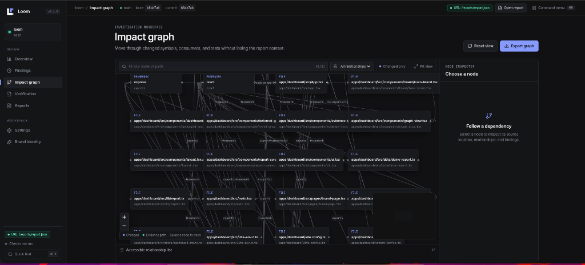

# Loom

**See what your changes touch.**

Loom is an open-source, local-first developer tool for change-impact
intelligence. Its deterministic core compares a Git base snapshot with the
working tree, parses TypeScript/JavaScript source with the TypeScript Compiler
API, builds an evidence-backed graph, and reports consumers of changed
contracts.

The optional dashboard is a presentation layer over real Loom reports; it does
not invent findings.



## Dashboard

The dashboard combines a compact dark developer-tool shell, evidence-first
finding detail, and a React Flow impact graph. It is local-first and connects
directly to authentic Loom reports produced by the CLI:

1. **Direct file upload**: Drag and drop any `.loom/reports/report.json` file directly into the dashboard or click "Select from disk". Web browsers cannot directly read arbitrary local filesystem paths via `fetch()`; selecting the file explicitly provides secure in-memory browser access.
2. **Local dev server**: Vite serves `.loom/reports/report.json` automatically at `/reports/report.json` and detects the workspace via `/api/workspace`.
3. **Environment or URL**: Set `VITE_LOOM_REPORT_URL=/reports/report.json` or pass `?report=/reports/report.json`. Configure custom workspace roots or report paths for the dev server using `LOOM_WORKSPACE_ROOT=/path/to/repo` and `LOOM_REPORT_FILE=.loom/reports/custom.json`.
4. **Provenance & Foreign Repository Visibility**: The dashboard actively compares the report repository against the local workspace name. If an imported report originates from a different repository, an amber provenance banner clearly alerts the user that external findings are being inspected.
5. **Explicit demo preview**: Demo mode is never loaded silently. When no report is configured, an honest connect screen is shown. Demo mode can be explicitly activated via `?demo=true` or by clicking "Launch demo fixture".

```bash
# In your repository, generate a complete report with graph:
node dist/cli.js report --format json --output .loom/reports/report.json

# Launch the dashboard:
npm --workspace apps/dashboard run dev -- --host 127.0.0.1 --port 4175

# Or launch targeting a specific workspace and report:
LOOM_WORKSPACE_ROOT=/path/to/repo VITE_LOOM_REPORT_URL=/reports/report.json npm --workspace apps/dashboard run dev -- --host 127.0.0.1 --port 4175
```

It supports overview, graph, findings, finding details, verification artifact
review, report download, settings, keyboard command navigation, and an
accessible relationship-list alternative to the graph. The dashboard does not
execute repository commands, persist report history, authenticate users, or
apply patches.

`qa:dashboard` uses the project-local Playwright dependency to capture the main
routes at desktop and narrow viewports, exercise the finding and graph controls,
and fail on console errors, failed requests, or horizontal overflow. Screenshots
default to `/tmp/loom-ui-qa`; set `LOOM_UI_QA_DIR` to choose another output
directory and `LOOM_DASHBOARD_URL` to target a different running server.

The visual system is documented in
[`design-system/loom/MASTER.md`](design-system/loom/MASTER.md). It uses a
Faultline-inspired technical dark palette (obsidian/zinc surfaces with ember/iris/proof accents),
Inter and JetBrains Mono type roles, 4px spacing rhythm, restrained borders, and
high-contrast WCAG AA status indicators for interaction, breaking risk, uncertainty, and explicit verification.

## Core engine status

The core engine and CLI are usable as a vertical slice. It currently supports:

- Git base/working-tree snapshots and repository-relative changed-file discovery
- exported TypeScript interfaces and object-literal type aliases
- named/default/namespace imports and type-only imports, including local
  relative re-exports
- typed property accesses, JSX element/prop evidence, and deterministic graph
  traversal through imports and re-exports
- removed fields, same-type field renames, required additions, and optional
  additions (optional additions are recorded but are not breaking findings)
- stable finding IDs, confidence, uncertainty, source positions, and impact
  paths
- JSON and text reports
- JSON-only configuration; Loom never evaluates configuration code or runs
  repository package scripts

See [docs/core-engine.md](docs/core-engine.md) for the data model and known
limitations.

## Requirements and setup

- Node.js `22.23.3` (pinned in `.nvmrc`)
- npm `10.9.9` or newer
- Git

Ensure normal strict TLS certificate validation is enabled in your environment (if inherited externally, run `unset NODE_TLS_REJECT_UNAUTHORIZED`).

```bash
npm ci
npm test
npm run build
node dist/cli.js --help
```

The shortest end-to-end demo is:

```bash
npm run build:cli
bash scripts/demo-contract-impact.sh
```

See [docs/demo.md](docs/demo.md) for the fixture and expected evidence path.

`make test` is the canonical offline check. It runs TypeScript checks for the CLI and dashboard plus the unit,
integration, and end-to-end tests. The tests create temporary Git repositories
and do not execute scripts from those repositories.

The dashboard workspace can also be checked independently:

```bash
npm --workspace apps/dashboard run typecheck
npm --workspace apps/dashboard run test
npm --workspace apps/dashboard run build
```

## CLI

All analysis commands use the current directory by default. `--root` selects a
repository and `--base` selects a Git commit; the default base is `HEAD` (or the
`base` value in `.loom/config.json`). Output paths and all report paths must be
repository-relative.

```bash
node dist/cli.js init
node dist/cli.js scan --base HEAD
node dist/cli.js impact --format json --output .loom/reports/impact.json
node dist/cli.js graph --format json
node dist/cli.js report --format json --output .loom/reports/report.json
node dist/cli.js explain finding-0123456789abcdef
node dist/cli.js doctor
node dist/cli.js test
node dist/cli.js test --run
node dist/cli.js ci --fail-on high
```

The package also exposes `loom` as its npm bin name when invoked through an npm
bin-aware environment.

`scan` reports contract changes and stale consumers. `impact` adds files that
transitively import changed modules. `graph` prints the current deterministic
graph. `report` includes that graph in the report document. `explain` resolves
one finding ID. `doctor` checks Git/configuration without invoking project
scripts. `ci` prints a report and exits non-zero when its threshold is met.

`report --format json` emits versioned `loom.report/v1` JSON with repository and
base metadata. The dashboard adapter accepts this engine report directly.

### Exit codes

The codes are stable across commands:

| Code | Meaning |
| ---: | --- |
| `0` | Command completed; `ci` found no finding at or above its threshold; `test` passed all checks or was not run |
| `1` | `ci` found a finding at or above `--fail-on`; `test --run` failed one or more verification checks |
| `2` | Usage, configuration, repository, or Git base error |
| `3` | Analysis or unexpected execution error |

`scan`, `impact`, `graph`, `report`, and `explain` return `0` when their
requested operation succeeds, even when findings are present. `test` returns `0`
when verification commands pass or when run without `--run` (dry inspect mode).

## Configuration

`loom init` creates `.loom/config.json`:

```json
{
  "base": "HEAD",
  "extensions": [".ts", ".tsx", ".js", ".jsx"],
  "exclude": ["node_modules", "dist", "build", "coverage", ".git"],
  "maxFiles": 10000,
  "maxFileBytes": 1000000,
  "verification": {
    "commands": [],
    "timeoutMs": 30000,
    "maxOutputBytes": 100000
  }
}
```

Only this strict JSON schema is accepted. Config paths, output paths, and
source paths are constrained to the repository. File count and file size
limits bound analysis work. There is no config hook, shell command, test
runner, or package-script execution in the core CLI.

## Framework signals and limitations

React is marked when the parser sees React imports or JSX. Express is marked
when it sees an Express import or common route/middleware property calls. These
are graph signals only; the engine does not claim framework-specific routing,
component lifecycle, or runtime behavior analysis.

The analyzer is intentionally conservative and syntax-oriented. It does not
resolve npm packages or aliases, infer arbitrary JavaScript types, model
reflection/dynamic property names, or execute tests/builds. Strong findings
come from explicit imported contract types and property accesses. A reachable
but unresolved transitive property access is reported with medium confidence
and an uncertainty explanation. JSX prop evidence is associated when the
imported component's module exposes an exported `*Props` contract. Declaration
merging, complex conditional/mapped types, generated files, and non-relative
package graphs are outside this slice.

## Design principles

- Deterministic analysis before AI assistance.
- Evidence and uncertainty are visible in every finding.
- Repository contents and commands are handled conservatively.
- No database server is required for core analysis.

## Docker

```bash
docker build -t loom .
docker run --rm -v "$PWD:/repo:ro" -w /repo loom doctor
docker run --rm -v "$PWD:/repo:ro" -w /repo loom scan --base HEAD --format json
```

The container runs the CLI as a non-root user. Git ownership and repository
access remain the caller's responsibility; do not disable Git safety checks
globally.

## CI

The repository workflow runs `npm ci`, `make test`, and `npm run build` on a
clean Ubuntu runner. A downstream project can install the package and run
`loom ci --base "$GITHUB_BASE_REF" --format json`; missing bases and incomplete
analysis should be treated as failures rather than a clean scan.

## Roadmap and honest limitations

The current release focuses on the TypeScript contract-impact vertical slice.
Express and React are represented through parser and graph signals; full route
serializer inference, Mongoose/OpenAPI adapters, migration planning, bounded
verification execution, incremental cache persistence, AI investigation, and
historical dashboard reports remain follow-up work. These capabilities must
consume the same evidence-backed report contract rather than inventing a
second analysis engine.

## License

MIT. See [LICENSE](LICENSE).
