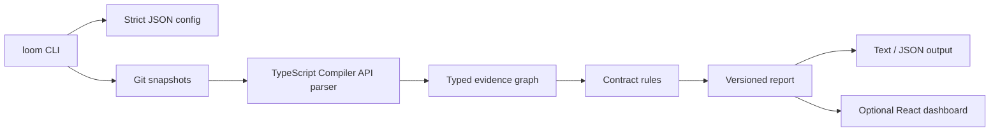

# Loom architecture

Loom is a local-first TypeScript package. The CLI is the application boundary;
the parser, graph, analysis rules, and report serializer are importable modules
that do not depend on React or an AI provider.

## Analysis flow

1. Loom resolves the repository root and requested Git base.
2. It reads the base from Git objects and the effective working tree from disk.
3. It parses source files into repository-relative modules, contracts, imports,
   property accesses, JSX usages, and framework signals.
4. It resolves local relationships with TypeScript's compiler API and builds a
   deterministic graph with evidence positions.
5. Contract rules compare matching exported declarations and trace old field
   consumers through reverse import paths.
6. Reports serialize findings, uncertainty, graph metadata, and source evidence.

The current engine is intentionally conservative. Runtime behavior, package
exports, generated files, and dynamic property names are not silently inferred.

## Boundaries

- `src/git.ts` owns repository reads and base validation.
- `src/parser.ts` owns syntax extraction.
- `src/graph.ts` owns node/edge identity and traversal.
- `src/analysis.ts` owns contract comparison and finding classification.
- `src/report.ts` owns stable text and JSON presentation.
- `apps/dashboard` validates report artifacts and renders them; it does not
  reimplement analysis.
